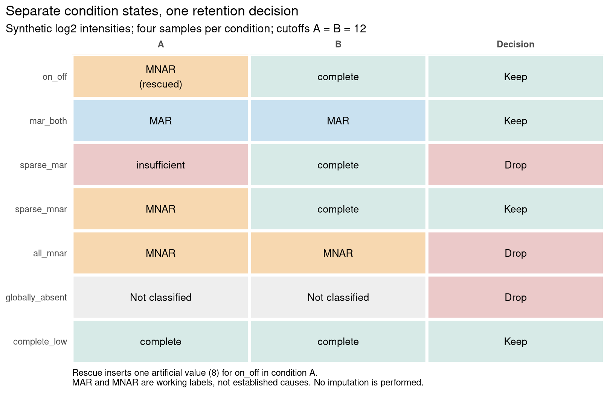

# ImputeFinder

ImputeFinder classifies missing protein intensities separately within each
condition, preserving on/off patterns that pooling can hide. Results contain
filtered data, feature-condition states, and retention or drop reasons.

The package expects **unnormalised log2 protein intensities**. It classifies and
prepares data; it does not normalise or impute them.

Use it to separate low-intensity missing blocks from better-observed blocks
for downstream treatment. **Likely missing-not-at-random (MNAR)** and **likely
missing-at-random (MAR)** are cutoff-based labels, not proven causes of
missingness.

## Installation

The development package is not yet in Bioconductor. It requires R 4.6 or later
and a compatible Bioconductor library. Install from GitHub:

```r
install.packages(c("BiocManager", "remotes"))
BiocManager::install("eturkes/imputefinder")
```

## First result

After installation, run this from a writable folder. Seven synthetic features
in two conditions produce the figure below without downloads. The manual
cutoffs are illustrative, not recommendations.

```r
source(system.file("examples", "quickstart.R", package = "imputefinder",
    mustWork = TRUE))
```

```text
<imputefinder_result>
Retained 4 of 7 features; dropped 3.
Analysed 8 samples in 2 conditions; inserted 1 rescue value.
A: retained features include 2 MNAR, 1 MAR, 1 complete, 0 absent; cutoff 12 (manual)
B: retained features include 0 MNAR, 1 MAR, 3 complete, 0 absent; cutoff 12 (manual)
```



Read each row across A, B, and retention. `on_off` stays because B is complete;
one logged artificial value enables classification in A, not complete
imputation. `sparse_mar` is dropped because its high-intensity block lacks an
observed majority in A. `complete_low` stays because nothing is missing.

The script writes these files under `imputefinder-results/`:

| File | Contents |
|---|---|
| `classifications.png` | The labelled state and retention figure, at 180 dpi |
| `classifications.csv` | Original counts, processed means, cutoffs, states, and rescue flags |
| `feature-status.csv` | Every original feature's retention decision and drop reason |
| `retained-intensities.csv` | The four retained rows, including the rescue value |
| `seed-log.csv` | Every inserted value and its location |
| `result.rds` | The full result, for `readRDS()` |

Re-running replaces these files. The script leaves `x`, `condition`, `fit`,
and `state_plot` in R. Edit the [example script](inst/examples/quickstart.R)
to change inputs or figures.

## Classify your data

Replace `x` with unnormalised log2 intensities, with named features in rows and
uniquely named samples in columns. Align `condition` with the columns. Use `NA`
for missingness; zero stays observed. Choose experiment-specific cutoffs rather
than copying 12:

```r
library(imputefinder)

fit <- classify_missingness(
    x, group = condition, cutoffs = c(A = 12, B = 12),
    rescue = "minimum", seed = 1L
)
fit$feature_status
fit$seed_log
plot_missingness(fit, "A")
```

The plot shows the stored profile and cutoff, which is manual here.
`cutoffs = NULL` requests automatic selection; unsupported profiles need a
manual decision. Use `rescue = "none"` to keep unobserved blocks `absent`
without insertions. Handle them separately from MAR and MNAR. Normalisation
and imputation remain downstream choices.

<details>
<summary>Classification rules, rescue, cutoffs, and downstream workflow</summary>

## Classification rules

Each feature-condition block receives one state after the selected rescue policy:

| State | Rule | Downstream group |
|---|---|---|
| `complete` | No values are missing | `MAR_or_complete` |
| `MNAR` | Values are missing and the observed arithmetic mean is below the condition cutoff | `MNAR` |
| `MAR` | Values are missing, the mean is at or above the cutoff, and strictly more than half of the samples are observed | `MAR_or_complete` |
| `insufficient` | Values are missing, the mean is at or above the cutoff, and no strict observed majority exists | Feature is dropped |
| `absent` | No original values are observed and `rescue = "none"` | `absent`; no mechanism is assigned |

Equality falls on the MAR side; the majority rule applies only to MAR
candidates. Retention requires no `insufficient` condition and at least one
`complete` or `MAR` condition. Globally missing and all-MNAR/absent features
are dropped.

## How rescue works

An unobserved block has no mean. Before classification, the default
`rescue = "minimum"`:

1. Removes globally missing features and marks them `all_missing`.
2. Calculates each condition's minimum finite intensity before inserting values.
3. Inserts that minimum into one uniformly selected sample per surviving,
   fully missing block. Other cells stay `NA`.
4. Records every insertion in `seed_log`.

For the worked fixture:

```r
fit$seed_log
#>   feature condition sample old_value inserted_value seed
#> 1  on_off         A     s1        NA              8    1
```

Rescue enables classification, not complete imputation. With fixed data and
`seed`, sample selection is invariant to row or column order; the default is
`seed = 1L`. The input, original observations, and global random-number state
stay unchanged. Rescue values remain in `fit$data` and can affect downstream
normalisation and inference.

### Classify without synthetic values

Use `rescue = "none"` to preserve missing cells and record absence separately:

```r
unseeded <- classify_missingness(
    x,
    group = condition,
    cutoffs = c(A = 12, B = 12),
    rescue = "none"
)
unseeded$groups$A$absent
#> [1] "on_off"
unseeded$classifications[
    unseeded$classifications$feature == "on_off",
    c("condition", "state", "original_observed_count",
      "original_missing_count", "original_mean_intensity")
]
```

Absent blocks have no mean or cutoff and do not enter density or cutoff
estimation. Unobserved conditions receive empty labelled plots. Globally
missing features are still dropped as `all_missing`. Features that are MNAR
or absent everywhere receive `MNAR_or_absent_all_conditions` when any block is
absent.

Keep `absent` separate until its treatment is specified. The label establishes
neither a MAR/MNAR mechanism nor biological absence.

## Manual and automatic cutoffs

For a predefined boundary, supply named finite cutoffs. Partial vectors use
automatic selection for omitted conditions. Out-of-range cutoffs are accepted
with a recorded warning.

With `cutoffs = NULL`, automatic selection runs independently for conditions
with partially observed blocks. Complete or fully absent blocks need no cutoff:

```r
fit_auto <- classify_missingness(
    intensity_matrix,
    group = sample_condition
)
```

Automatic selection estimates the proportion of incomplete features across
mean intensity. At intensity `x`, the curve is:

```text
n_missing f_missing(x)
-----------------------------------------------
n_missing f_missing(x) + n_complete f_complete(x)
```

The detector selects the lower, right-hand boundary of the lowest credible
downward transition. `cutoff_diagnostics` stores the method version, support,
and warnings. Multiple transitions trigger a warning by default, also shown
in the caption. Use `ambiguity = "error"` to require a manual decision or
`"lowest"` to accept the selection without signalling. All policies retain
stored warnings.

`quality$candidate_transitions` records candidate cutoffs and support, not
confidence intervals or calibrated probabilities. Selection does not establish
a unique biological boundary.

Strict failures inherit from `imputefinder_cutoff_ambiguous` and
`imputefinder_cutoff_error`. They retain `profile`, `diagnostic`, and `condition`
fields. A named manual cutoff bypasses automatic ambiguity for that condition.

Small, flat, or unsupported profiles produce an explanation and require a
manual cutoff. Use manual values for small examples like this one.

Plotting uses the stored profile and cutoff:

```r
plot_missingness(fit, "A")
fit$cutoff_diagnostics$A
```

Bottom rug ticks identify rescued feature-condition blocks. The vertical line
is the recorded cutoff.

## What the result contains

`classify_missingness()` returns an `imputefinder_result` with these components:

| Component | Contents |
|---|---|
| `data` | Filtered data with any recorded rescue values; the input representation and metadata are preserved |
| `classifications` | Processed statistics, original observed and missing counts, original means, and final states for each surviving feature-condition block |
| `groups` | Retained `MNAR`, `MAR`, `complete`, `MAR_or_complete`, and `absent` feature names for every condition |
| `feature_status` | One row per original feature with its retention decision and drop reason |
| `cutoffs` | Named condition-specific numeric cutoffs |
| `cutoff_diagnostics` | Whether each cutoff was manual, automatic, or unnecessary, together with method details and warnings |
| `profiles` | Feature statistics and the density grid used for each condition |
| `seed_log` | The feature, condition, selected sample, inserted value, and seed for every rescue, including rescues on features later dropped |
| `groups_by_sample` | Condition vector named and ordered by output samples |
| `call` | The matched call used to create the result |
| `policies` | Resolved rescue and ambiguity policies |
| `assay_index` | Position of the classified experiment assay, or `NULL` for matrix input |

`summary(fit)` reports state and drop counts, including `seeded_complete` blocks
made complete solely by rescue. Original evidence remains in
`original_observed_count`, `original_missing_count`, and
`original_mean_intensity`. Plotting needs only the stored result.

For a `SummarizedExperiment`, select the condition column explicitly and select
the assay whenever more than one is present:

```r
fit_se <- classify_missingness(
    se,
    group_col = "condition",
    assay = "log2_intensity",
    cutoffs = c(A = 12, B = 12)
)
```

## Downstream normalisation and imputation

The intended pipeline is:

1. Run ImputeFinder on unnormalised log2 intensities.
2. Use `fit$data`, containing retained features and their rescue values.
3. Apply the chosen normalisation to the entire returned object.
4. Split columns by `fit$groups_by_sample`.
5. Within each condition, apply MNAR and MAR methods to its `MNAR` and
   `MAR_or_complete` groups, respectively.
6. Recombine conditions in the original sample order.

With `rescue = "none"`, handle `fit$groups[[condition]]$absent` separately.
Both policies can leave missing values. These indices isolate the two branches
without choosing an imputation package:

```r
condition_name <- "A"
sample_names <- names(fit$groups_by_sample)[
    fit$groups_by_sample == condition_name
]
condition_data <- fit$data[, sample_names, drop = FALSE]

mnar_rows <- fit$groups[[condition_name]]$MNAR
mar_rows <- fit$groups[[condition_name]]$MAR_or_complete

condition_data[mnar_rows, , drop = FALSE]
condition_data[mar_rows, , drop = FALSE]
```

### Select only missing cells

Use `missingness_mask()` to identify replacement targets in the retained data:

```r
mnar_mask <- missingness_mask(fit, "MNAR")
mar_mask <- missingness_mask(fit, "MAR")
absent_mask <- missingness_mask(fit, "absent")
stopifnot(identical(mnar_mask | mar_mask | absent_mask, is.na(fit$data)))
```

Masks preserve data dimensions, names, and order. Only remaining missing cells
are `TRUE`; observations and rescue values are `FALSE`. Dropped features have
no rows.

Create masks before normalisation or imputation. Align replacement matrices by
feature and sample names. Masks select targets, not an imputer's full training
data.

For experiment results, masks use the recorded assay. Keep assay order
unchanged. Older multi-assay results without `assay_index` need reclassification.

Normalisation and imputers such as kNN, MinProb, MinDet, QRILC, or BPCA remain
external choices, not defaults or runtime dependencies.

</details>

## Further reading

The [vignette](vignettes/imputefinder.Rmd) covers automatic cutoffs, sensitivity
checks, downstream branching, and a bundled PXD020717 Tau-phosphosite extract.
The selected real-data example demonstrates classification, not disease effects.

To read the rendered vignette, install suggested dependencies and build with
`build_vignettes = TRUE`, then run `vignette("imputefinder")`. The first-run
script needs no vignette build. Use `citation("imputefinder")` for citation details.

Regenerate the figure with `Rscript tools/render-quickstart.R`. Tests run the
same example and check classifications and exports.

## Verification

Deterministic tests compare output with known states under manual and automatic
cutoffs. They cover intensity-independent MAR, intensity-dependent MNAR, on/off
features, unequal groups, rescue reproducibility, input-order invariance, and
unsupported profiles. They verify behavior under specified models, not accuracy
for arbitrary proteomics experiments.

Run the committed build and check from the repository root:

```sh
Rscript tools/check-package.R
Rscript tools/check-package.R --bioc
```

Install dependencies first. The second command adds BiocCheck; logs remain
under `.checks/`. Both run examples, tests, and vignettes. CI targets Linux,
macOS, Windows, and Linux with R-devel; configured jobs are not evidence of
hosted passes.

## Limitations

- Input checks verify structure and finiteness, not whether values are
  unnormalised log2 intensities.
- The cutoff assumes a descending intensity transition that biology,
  acquisition, or preprocessing may violate. Automatic selection needs both
  incomplete and complete features; unsupported profiles require manual values.
- Arithmetic means deliberately allow strong observations to move blocks toward
  MAR, making them sensitive to unusual values.
- Rescue values remain artificial observations in the returned data and log.
  Assess their downstream effect. In one-sample conditions, rescue makes absent
  blocks `complete`; inspect original counts, `seeded`, and `seed_log`, or use
  `rescue = "none"`. Within-condition missingness assessment needs replication.
- Classification neither proves missingness mechanisms nor chooses, runs, or
  validates imputation methods.

## License

ImputeFinder is distributed under GPL-3.0-or-later. See [COPYING](COPYING).
